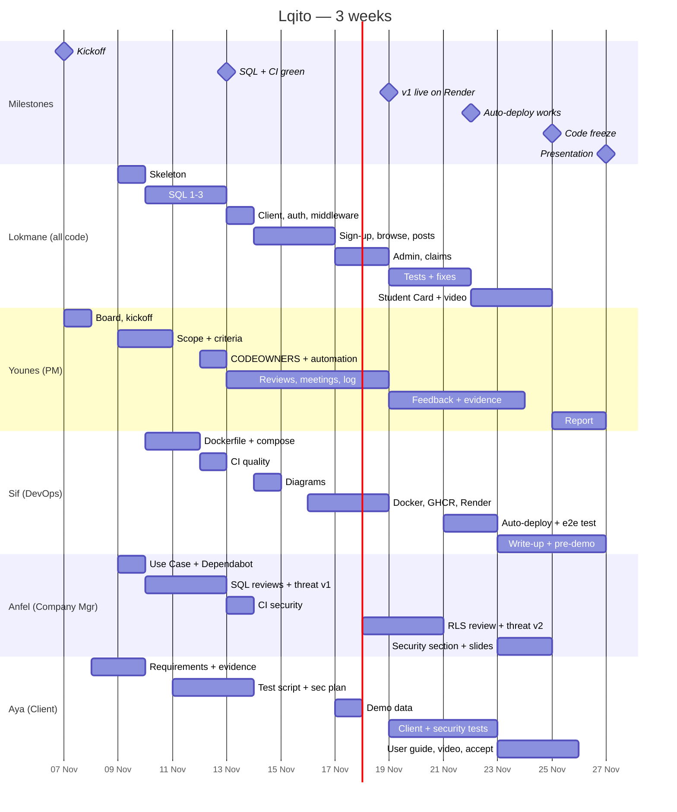

# Project Plan — Lqito (University Lost & Found)

**What we build:** `docs/PROJECT.md`. Read it first. **How it looks:** `docs/design-system.md`.
**Dates:** Sat Nov 7 → Fri Nov 27, 2026 (presentation; confirm the date and length with the professor).
**Rules:**
- **Only Lokmane writes the website code** (frontend, backend, SQL, tests), with AI help. Nobody else edits files in `src/`, `supabase/` or `tests/`.
- The other 4 members have **the same amount of work (11 points each)** in their own files: DevOps files, security files, documents and tests by hand.
- Claude guides, reviews and fixes problems.
- Every task is one GitHub Issue (a card on the board), one branch, one pull request, one approval.

## How to use this plan

- **Your tasks are in your own file:** [Lokmane](tasks/lokmane.md) · [Younes](tasks/younes.md) · [Sif](tasks/sif.md) · [Anfel](tasks/anfel.md) · [Aya](tasks/aya.md). Open it every morning. This file (PLAN.md) has the rules, the split and a calendar of the whole team.
- Card format: **Title — Owner — Due — Done when**. Each card becomes a GitHub Issue: Title = issue title, Owner = Assignee, Due = the board's `Due` date, Done when = issue body.
- The **AI:** line under a card is what to ask your AI assistant if you are stuck.
- Board: **GitHub Projects** (repo → Projects → New project → Board). Columns: `Backlog | This Week | In Progress | In Review | Done`. Fields: `Due` (date), `Week` (1, 2, 3), `Points` (number). Labels: `app`, `sql`, `devops`, `security`, `docs`, `test`, `must-fix`, `nice-to-have`.
- Write `Closes #<issue>` in the PR description. When the PR is merged, the card moves to Done by itself.
- When a card is done, add a row to **"My work log"** at the bottom of your own `docs/tasks/<name>.md` (date, task, time, link). Younes copies all 5 into `docs/work-log.md` every Friday.
- **How we prove our work and our meetings:** `docs/evidence/README.md`. Minutes use `docs/minutes/TEMPLATE.md`.
- Never paste a key, token or password into an AI chat, WhatsApp, an issue or a PR. Write `XXXX` instead.

## Who does what

1 point ≈ half a day of work.

| Member | Title (story) | Owns | Points |
|---|---|---|---|
| **Lokmane** | Developer | **All website code:** skeleton, SQL (tables, RLS, functions), Supabase client, sign-up/login, posts, search, admin dashboard, claims, middleware (CSP, headers), `/api/health`, tests, Student Card change | ~30 (see "Lokmane's safety cuts") |
| **Younes** | Project Manager | Board, issues, CODEOWNERS, meetings, minutes, work log, evidence, report assembly — 7; scope + acceptance criteria — 2; **functional review of every app PR** (runs it locally, clicks through) — 2 | **11** |
| **Sif** | DevOps Engineer | Dockerfile + compose — 2; CI quality workflow — 2; GHCR + Render + auto-deploy + pipeline test — 4; CI/CD + architecture diagrams + pipeline write-up — 2; pre-demo check — 1 | **11** |
| **Anfel** | Company Manager | Use Case diagram — 1; CI security workflows (npm audit, gitleaks, CodeQL), Dependabot, PR template — 3; **security review of every SQL PR** — 2; threat model v1 + v2 + security section — 4; slides assembly — 1 | **11** |
| **Aya** | Client | Requirements + problem evidence — 1; test script + guided client test + acceptance — 3; security tests (2 rounds) + accessibility test — 4; demo data — 1; user guide — 1; backup video — 1 | **11** |

**Everyone also:** writes their own 2 slides and their "What I learned" paragraph, and comes to the rehearsals.

### Lokmane's safety cuts

Writing all the code alone is about 30 points in 11 days. If on **Mon Nov 16** the board shows Lokmane is more than 1 day late, drop these in this order (they move to "Could"):
1. Ban a user (keep approve / reject)
2. Admin "Log" tab (the `admin_log` table still records everything)
3. Type and category filters (keep the search box)

Nobody else writes app code to "help". They help by testing fast and reporting clear issues.

## Who touches which files (so the code never gets mixed)

| Files | Only this person edits them | Reviewer |
|---|---|---|
| `src/`, `supabase/`, `tests/`, `package.json`, `next.config.ts`, `middleware.ts` | Lokmane | Younes (does it work?) + Anfel for `supabase/` (is it safe?) |
| `Dockerfile`, `docker-compose.yml`, `.dockerignore`, `.github/workflows/ci.yml`, `.github/workflows/deploy.yml` | Sif | Lokmane |
| `.github/workflows/security.yml`, `.github/workflows/codeql.yml`, `.github/dependabot.yml`, `.github/pull_request_template.md` | Anfel | Sif |
| `.github/CODEOWNERS`, `docs/minutes/TEMPLATE.md`, `docs/work-log.md`, `docs/evidence/`, `docs/scope.md`, `docs/report/REPORT.md` | Younes | Anfel |
| `docs/minutes/<date>.md` | the note-taker of that meeting (rotation below) | anyone who attended |
| `docs/diagrams/cicd.md`, `docs/diagrams/architecture.md`, `docs/report/cicd.md` | Sif | Younes |
| `docs/diagrams/use-case.md`, `docs/threat-model.md`, `docs/report/security.md` | Anfel | Aya |
| `docs/client-requirements.md`, `docs/tests/`, `docs/acceptance.md`, `docs/user-guide.md`, `docs/evidence/client/` | Aya | Younes |
| `docs/tasks/<name>.md`, `docs/team/<name>.md`, `docs/report/learned-<name>.md` | each member, their own file | anyone |

- **No two people edit the same file**, so there are no Git conflicts.
- If you need a change in someone else's file, open an **issue** and assign it to the owner. Don't edit it yourself.
- `.github/CODEOWNERS` (Younes) writes this table for GitHub, so the right reviewer is asked automatically.
- Lokmane keeps PRs small (one card = one PR) and runs `npm run format` before each commit. CI fails if the format is wrong.

## Milestones

| Date | Milestone |
|---|---|
| Sat Nov 7 | Kickoff, everyone has access |
| Fri Nov 13 | All SQL done, app skeleton, Docker, CI green |
| Thu Nov 19 | All v1 features on the live Render URL |
| Sun Nov 22 | Auto-deploy works end to end |
| Wed Nov 25 | Code freeze |
| Fri Nov 27 | Presentation |

---

## Calendar (overview)

**The details of every task are in each member's file:** [Lokmane](tasks/lokmane.md) · [Younes](tasks/younes.md) · [Sif](tasks/sif.md) · [Anfel](tasks/anfel.md) · [Aya](tasks/aya.md).
This table only shows the task titles, so Younes can see the whole team on one page. If a task changes, change it in the member's file first (Younes updates this table).

Every app PR: Lokmane opens it, CI must be green, Younes runs it locally and approves.


### Week 1 — Foundations (Nov 7 → Nov 13)

| Day | Lokmane | Younes | Sif | Anfel | Aya |
|---|---|---|---|---|---|
| Sat 7 | Invite everyone to the repo<br>GitHub 2FA and SSH key | Create the board and Week 1 issues<br>Kickoff meeting<br>GitHub 2FA and SSH key | GitHub 2FA and SSH key | GitHub 2FA and SSH key | GitHub 2FA and SSH key |
| Sun 8 | First PR: team file<br>PR: PROJECT.md, PLAN.md, CLAUDE.md, design system<br>Dev setup | First PR: team file<br>Dev setup | First PR: team file<br>Dev setup | First PR: team file | First PR: team file<br>Client requirements |
| Mon 9 | App skeleton | Scope | — | Use Case diagram<br>Dependabot and PR template | Problem evidence |
| Tue 10 | SQL 1: profiles, posts, RLS, trigger | Acceptance criteria | Dockerfile | Security review: SQL 1 | — |
| Wed 11 | SQL 2: search and admin | — | docker-compose | Threat model v1<br>Security review: SQL 2 | Test script |
| Thu 12 | SQL 3: claims + test SQL | Board automation + CODEOWNERS | CI: quality workflow | Security review: SQL 3 | — |
| Fri 13 | Supabase client, auth helpers, zod, middleware | Weekly meeting #2 | — | CI: security workflows | Security test plan |

### Week 2 — Features, deploy, client test (Nov 14 → Nov 20)

| Day | Lokmane | Younes | Sif | Anfel | Aya |
|---|---|---|---|---|---|
| Sat 14 | F1: sign-up, login, logout, pending page | Week 2 issues | CI/CD and architecture diagrams | — | — |
| Sun 15 | F5 + F6: home, search, filters, post details | Admin account for testing | — | — | — |
| Mon 16 | F3 + F9: create post, My page, close post | Safety-cut check | App in Docker with the real database | — | — |
| Tue 17 | F2 + F4 + F10: admin dashboard | — | Push the image to GHCR | — | Demo data plan |
| Wed 18 | F7 + F8: claims | — | Render service | RLS review | — |
| Thu 19 | Data-layer tests | Prioritize the feedback<br>Start the evidence folder | — | — | Guided client test |
| Fri 20 | Fix must-fix issues (batch 1) | Weekly meeting #3 | — | Threat model v2 | Security tests round 1 + accessibility test |

### Week 3 — Auto-deploy, live change, report, presentation (Nov 21 → Nov 27)

| Day | Lokmane | Younes | Sif | Anfel | Aya |
|---|---|---|---|---|---|
| Sat 21 | Fix must-fix issues (batch 2) | Week 3 issues | Auto-deploy | — | Load the demo data |
| Sun 22 | Student Card migration (applied in advance) | — | Pipeline end-to-end test | — | Security tests round 2 |
| Mon 23 | Student Card code (draft PR, not merged) | Collect the evidence | Pipeline write-up | Security section | User guide |
| Tue 24 | Backup video<br>Own slides + "What I learned" | Own slides + "What I learned" | Own slides + "What I learned" | Own slides + "What I learned"<br>Slides assembled | Backup video<br>Own slides + "What I learned" |
| Wed 25 | Code freeze<br>Rehearsal 1 (timed) | Final report draft<br>Rehearsal 1 (timed) | Rehearsal 1 (timed) | Rehearsal 1 (timed) | Final acceptance test<br>Rehearsal 1 (timed) |
| Thu 26 | Rehearsal 2 + report merged | Rehearsal 2 + report merged | Rehearsal 2 + report merged<br>Pre-demo check | Rehearsal 2 + report merged | Rehearsal 2 + report merged |
| Fri 27 | Presentation | Presentation | Presentation | Presentation | Presentation |

---

## Weekly routine

- Every day at 21:00, Younes checks the board and messages the owner of any card stuck for more than 1 day.
- Every Friday 20:00 meeting: each member answers what did I finish, what's next, what's blocking me. Members take turns writing the minutes:

  | Meeting | Note-taker |
  |---|---|
  | Sat Nov 7 (kickoff) | Younes |
  | Fri Nov 13 (weekly #2) | Sif |
  | Fri Nov 20 (weekly #3) | Anfel |
  | Wed Nov 25 (rehearsal 1) | Aya |
  | Thu Nov 26 (rehearsal 2) | Lokmane |

  The note-taker takes the Meet screenshot (with everyone's OK) and opens the minutes PR the same evening.
- After each meeting, Younes tells Claude what each member finished and what is blocking.

## Environment variables

| Name | Where | Value |
|---|---|---|
| `SUPABASE_URL` | `.env` (local), Render | Supabase → Project Settings → Data API |
| `SUPABASE_PUBLISHABLE_KEY` | `.env` (local), Render | Supabase → Project Settings → API Keys → `sb_publishable_...` |
| `RENDER_DEPLOY_HOOK_URL` | GitHub Secret only | Render → service → Settings → Deploy Hook |

No `NEXT_PUBLIC_` prefix. **No secret key (`sb_secret_...`) or service_role key anywhere.** The app refuses to start if the key starts with `sb_secret_`.

## First admin

There is no way to become admin from the website. After Younes signs up, Lokmane runs in the SQL Editor:
```sql
update public.profiles set role = 'admin', status = 'approved'
where id = '<Younes user id from Authentication → Users>';
```

## Test SQL (Lokmane runs it, Anfel checks it; proves RLS and the functions work)

First create two test accounts on the site: one left `pending`, one approved. Copy their ids from Authentication → Users.

```sql
-- 1. As a visitor
begin;
set local role anon;
select count(*) from public.profiles;                   -- must be 0
select count(*) from public.posts where status = 'pending';  -- must be 0
insert into public.posts (type, category, title, description, location)
  values ('lost', 'keys', 'x', 'xxxxxxxxxx', 'xx');      -- must fail: permission denied
rollback;

-- 2. As a PENDING student
begin;
set local role authenticated;
select set_config('request.jwt.claims', '{"sub":"<pending user id>","role":"authenticated"}', true);
select public.create_post('lost', 'keys', 'Lost keys', 'Blue keychain near the door', 'Library', current_date);
                                                         -- must fail: account not approved
rollback;

-- 3. As an APPROVED student
begin;
set local role authenticated;
select set_config('request.jwt.claims', '{"sub":"<approved user id>","role":"authenticated"}', true);
select count(*) from public.profiles;                   -- must be 1 (own row)
update public.profiles set role = 'admin';              -- must fail: permission denied
select public.admin_review_user('<pending user id>', 'approved');  -- must fail: not an admin
rollback;
```

## Known pitfalls (read before you start)

1. **`npm audit` reports a HIGH PostCSS issue in Next 15.** Don't run `npm audit fix --force` (it jumps to Next 16). Add `"overrides": { "postcss": "<latest 8.x>" }` to `package.json`.
2. **Plain `npm audit fix` can downgrade `@typescript-eslint` to v6, which crashes ESLint 9.** Override `@typescript-eslint/eslint-plugin` and `@typescript-eslint/parser` to the latest 8.x.
3. **CSP with a nonce only works on dynamic pages.** Put `export const dynamic = "force-dynamic"` in `src/app/layout.tsx`.
4. **Don't import zod or server files into client components.** Keep the category list in its own small file, `src/lib/categories.ts`.
5. **A moderate `minimatch` advisory is dev-only** (ESLint tooling). CI audits production dependencies at `high`, so it doesn't block. Write it in the security report as an accepted risk.
6. **gitleaks-action is free on personal accounts** (a license is needed only for organizations).
7. **Render's free plan sleeps after 15 minutes idle.** The first load takes about 50 s.
8. **Check `auth.uid() is null` first in every function** and raise an error. In SQL, `NULL = x` is `NULL`, not `false`, so a missing check can let a call through.
9. **Never read the role from `user_metadata` / `raw_user_meta_data`.** Users can change their own metadata. The trigger copies only `full_name` and `student_id`.
10. **Supabase's built-in email only sends to your team's addresses.** That's why "Confirm email" is off in v1.
11. **Admin checks happen on the server 3 times:** page, Server Action, SQL function. Hiding a button is not security.
12. **The Supabase free project pauses after 7 days without activity.** Restore it from the dashboard if it happens.

## Gantt chart


