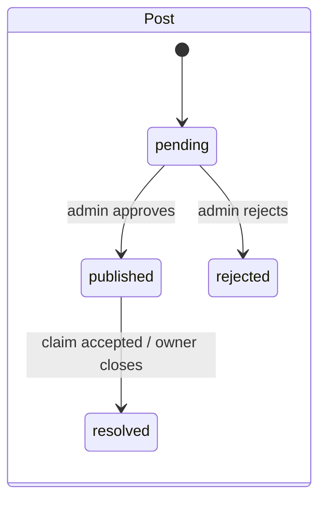
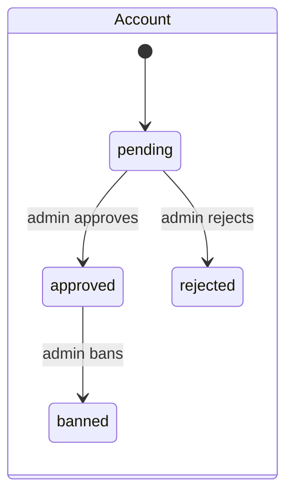
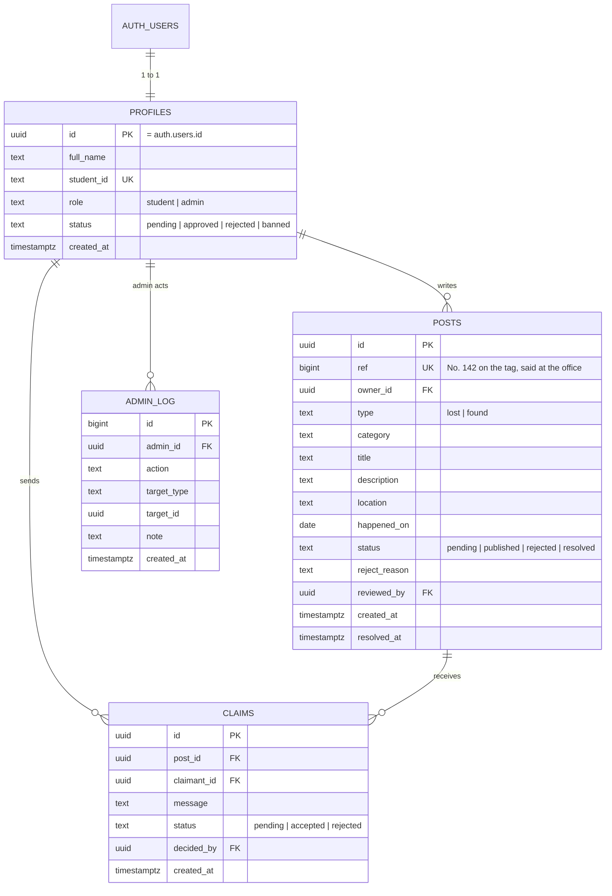
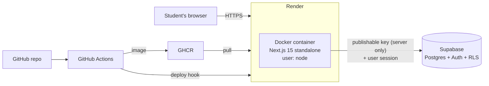
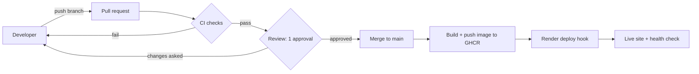

# Project Spec — Lqito (University Lost & Found)

> **Lqito** ("لقيتو", "I found it") is a working name. The team can change it on Day 1.
> This file says **what** we build and **why**. `docs/PLAN.md` says **who does what, and when**.

**One line:** a university website where verified students post what they lost or found, and an admin makes sure every item goes back to its real owner.

---

## 1. The problem

- Today students post lost items in Facebook groups. Posts get buried in a few hours, and there is no search or categories.
- Anyone can say "that's mine". Nobody checks, so items can go to the wrong person.
- Students post their phone number publicly to be contacted.
- The university has no record of what was lost, found or returned.

## 2. The solution

One platform with:
1. **Verified accounts:** a student signs up with their email and student ID, and an admin approves the account.
2. **Moderated posts:** every post is checked by an admin before it is public. No spam, no fake posts.
3. **Search and filters:** by keyword, type (lost / found) and category.
4. **Claims with proof:** to get an item back, the student describes something only the owner knows. The admin decides.
5. **Safe hand-over:** the item is handed over at the Lost & Found office (the admin). No phone numbers are online.
6. **History:** every admin decision is logged.

## 3. Goals and how we measure them

| Goal | Measure |
|---|---|
| A student finds a post fast | Search → post details in under 30 seconds, on a phone |
| Only real students act | 0 posts or claims from non-approved accounts (tested by Aya) |
| No personal data leaks | Student IDs never visible to visitors or other students (tested by Aya) |
| DevOps works end to end | A merged change is live in under 10 minutes, with no manual step |
| Clean security | 0 secrets in the repo (gitleaks), 0 high npm advisories, CodeQL green |
| Accessible | Lighthouse Accessibility ≥ 95, keyboard-only use works |

## 4. What the professor expects (from the course brief)

| Deliverable | Owner | Where |
|---|---|---|
| A working website | Lokmane (all code), Sif (deploy) | Live URL on Render |
| Use Case diagram | Anfel | `docs/diagrams/use-case.md` |
| CI/CD diagram | Sif | `docs/diagrams/cicd.md` |
| Architecture diagram | Sif | `docs/diagrams/architecture.md` |
| Presentation (a story between client and company) | Everyone (2 slides each), assembled by Anfel | Slides + live demo |
| Proof of teamwork: minutes, work log, board, commits | Younes | `docs/minutes/`, `docs/work-log.md`, `docs/evidence/` |
| A live change at the demo: "Student Card" category | Lokmane (change), Sif (pipeline) | PR merged live |

## 5. Users and roles

| Role | Who | Can |
|---|---|---|
| **Visitor** | Anyone, no account | See published posts, search, filter, open a post |
| **Pending student** | Signed up, not approved yet | Log in and see "Your account is waiting for approval". Nothing else. |
| **Student** | Approved account | Everything a visitor can + create posts, send claims, see "My posts" and "My claims", close their own post |
| **Admin** | University staff (in the demo: a team member) | Approve / reject accounts, posts and claims; ban users; read the admin log |
| **Banned** | Blocked by an admin | Log in and see "Your account is blocked". Nothing else. |

### Who sees what

| Data | Visitor | Student (others' data) | Owner | Admin |
|---|---|---|---|---|
| Published / resolved post | ✅ | ✅ | ✅ | ✅ |
| Pending / rejected post | ❌ | ❌ | ✅ | ✅ |
| Who wrote a post | ❌ | ❌ | ✅ | ✅ |
| Full name, student ID, email | ❌ | ❌ | ✅ (own) | ✅ |
| Claims | ❌ | ❌ | ✅ (own) | ✅ |
| Admin log | ❌ | ❌ | ❌ | ✅ |

## 6. Features

**Must (v1, needed for the presentation)**

| # | Feature |
|---|---|
| F1 | Sign up (email, password, full name, student ID), log in, log out |
| F2 | Account approval by an admin (pending → approved / rejected), ban a user |
| F3 | Create a post: type, category, title, description, location, date lost/found |
| F4 | Post review by an admin (pending → published / rejected with a reason) |
| F5 | Home page: published posts, newest first, search box, filters (type, category) |
| F6 | Post details page |
| F7 | Claims: "This is mine" (on found posts) or "I found it" (on lost posts) with a message |
| F8 | Claim decision by an admin; accepting resolves the post and shows hand-over instructions |
| F9 | "My page": my posts and my claims with their status; close my own post |
| F10 | Admin dashboard: tabs Accounts, Posts, Claims, Log, with pending counts |
| F11 | Health check `/api/health` (for Docker and Render) |

**Could (v2, only if v1 is done and Anfel approves)**
Photos on posts · email notifications · password reset by email · "Report this post" button · auto-hide posts older than 30 days · suggested matches (lost ↔ found, same category) · statistics page · Arabic / French interface.

**Won't (out of scope)**
Chat between students · mobile app · payments or rewards · login with Google.

## 7. User journeys

**Sara loses her earbuds**
1. Sara signs up with her email and student ID. She sees "Waiting for approval".
2. The admin checks her student ID and approves her.
3. Sara posts *Lost — Electronics — "White earbuds case" — Library, 2nd floor*. Status: Pending.
4. The admin approves the post. It is now on the home page.

**Karim found them**
5. Karim searches "earbuds", opens Sara's post and clicks **"I found it"**: *"Found on a table near the window, I gave them to the office."*
6. The admin accepts the claim. Sara's post becomes **Resolved**. Sara sees on "My page": *"Good news: go to the Lost & Found office with your student card."*

**The other way round (found item)**
1. Amine posts *Found — Keys — "Keys with a red Barça keychain" — Cafeteria*.
2. Two students click **"This is mine"**. One writes *"3 keys, a red Barça keychain and a small USB stick"*, the other only writes *"they are mine"*.
3. The admin accepts the claim with the right details and rejects the other one.

## 8. Pages (how the platform looks)

| URL | Who | Shows |
|---|---|---|
| `/` | Everyone | Search bar, filters (Lost/Found, category), list of post cards |
| `/posts/[id]` | Everyone | Full post; for students a claim form; for the owner a "Close post" button |
| `/signup`, `/login` | Visitors | Forms |
| `/pending` | Pending / banned users | Status message |
| `/new` | Students | New post form |
| `/me` | Students | Tabs "My posts" and "My claims" with status badges |
| `/admin` | Admins | Tabs Accounts · Posts · Claims · Log, each with Approve / Reject |

Header: logo (→ `/`) · "New post" button · "My page" or "Log in" · "Admin" link for admins only.

**Home page (phone)**
```
┌──────────────────────────────┐
│ Lqito            [+ New post]│
├──────────────────────────────┤
│ [ Search posts...      ] [🔍]│
│ (All) (Lost) (Found)  [Cat ▾]│
├──────────────────────────────┤
│ LOST · Electronics           │
│ White earbuds case           │
│ Library 2nd floor · 6 Nov    │
├──────────────────────────────┤
│ FOUND · Keys     ✓ Resolved  │
│ Keys with red keychain       │
│ Cafeteria · 5 Nov            │
└──────────────────────────────┘
```

**Admin dashboard**
```
┌──────────────────────────────────────────────┐
│ Admin   [Accounts 3] [Posts 5] [Claims 2] [Log]│
├──────────────────────────────────────────────┤
│ Name         Student ID   Signed up          │
│ Sara B.      2023xxxx     6 Nov  [Approve][Reject] │
│ Karim M.     2022xxxx     6 Nov  [Approve][Reject] │
└──────────────────────────────────────────────┘
```
Colors, fonts and components: `docs/design-system.md`.

## 9. Business rules

- A post is public only when `published` or `resolved`.
- A student can create **5 posts per day** at most.
- A student can send **1 claim per post**, never on their own post, only on `published` posts.
- Accepting a claim sets the post to `resolved` and rejects the other pending claims on it.
- The owner can close their own post at any time (for example, they found the item themselves).
- An admin cannot approve their own post or claim (no conflict of interest).
- A banned user's posts are hidden (set to `rejected` with reason "Account banned").





## 10. Data model



Categories (v1): `electronics, keys, bags, clothing, documents, other`. `student_card` is added live at the presentation.

## 11. Security design

This is a cybersecurity team: security is part of the grade.

| Threat | Control |
|---|---|
| Fake or spam accounts | Admin approves every account by student ID; 5 posts/day limit |
| A student makes themselves admin | Role stored only in `profiles`, set by a trigger, never read from `user_metadata`; no UPDATE grant on tables |
| Reading other students' data | RLS: own row only; `student_id` never in public queries |
| Writing directly to the database with the public key | No INSERT/UPDATE/DELETE grants; writes only through `security definer` functions that check `auth.uid()` and the role |
| Someone claims an item that isn't theirs | Claim needs proof; admin decides; hand-over in person with the student card |
| Admin pages opened by a student | Checked 3 times on the server: page (404), Server Action, SQL function (`is_admin()`) |
| XSS | React escapes output; no `dangerouslySetInnerHTML`; CSP with a nonce |
| SQL injection | Parameters only through RPC; no SQL or filter strings built from input; `%`/`_` escaped in search |
| Stolen session | Supabase session in HttpOnly cookies (`@supabase/ssr`); HTTPS only (HSTS) |
| Leaked secrets | Only the publishable key, on the server; `sb_secret_` / service_role never used; gitleaks + push protection |
| Vulnerable packages | Dependabot, `npm audit` in CI, CodeQL |
| A bad container | Non-root user, read-only filesystem, `cap_drop: ALL`, small Alpine image |

**Accepted risks (write them in the report):** email addresses are not verified in v1 (Supabase's built-in email only sends to team addresses; the student ID check replaces it); no automatic backups on the free Supabase plan; no rate limit on login beyond Supabase's defaults.

## 12. Architecture and stack



| Part | Choice | Why |
|---|---|---|
| App | Next.js 15 (App Router) + TypeScript | Pages and server code in one app; Server Actions keep the key on the server; one container |
| Database + login | Supabase (Postgres + Auth), region eu-central-1 | Free; real Postgres with RLS; ready-made accounts and sessions |
| Validation | zod | Same rules for every form, checked on the server |
| Tests | Vitest | Fast, works with TypeScript |
| Container | Docker, multi-stage, `node:24-alpine` | Same app on every laptop, in CI and on Render |
| Registry | GHCR | Free with `GITHUB_TOKEN` |
| Hosting | Render free | Runs a Docker image, gives HTTPS, deploy hook |
| CI/CD | GitHub Actions | Free for public repos; in the same place as the code |
| Board | GitHub Projects | Linked to issues and PRs, so the evidence is automatic |

## 13. DevOps design

- **Branches:** `main` is protected (PR + 1 approval + green checks, no bypass). One issue = one branch = one PR.
- **CI on every PR:** install → lint → typecheck → test → build → `npm audit` → gitleaks → CodeQL → Docker build.
- **CD on `main`:** build image → push `ghcr.io/<owner>/uni-lost-and-found:<sha>` and `:latest` → call the Render deploy hook → Render checks `/api/health`.
- **Environments:** local (`npm run dev` or `docker compose up`) and production (Render). Both use the same Supabase project for v1. A second "staging" Supabase project is v2.
- **Database changes:** SQL files in `supabase/migrations/`, reviewed in a PR, then applied in the Supabase SQL Editor by Lokmane, in date order. Applying them from CI is v2 (it needs a database secret in CI).
- **Config:** only 2 env vars, `SUPABASE_URL` and `SUPABASE_PUBLISHABLE_KEY`. In `.env` locally (never committed) and in Render's Environment tab.
- **Monitoring:** Render logs + the `/api/health` check. Optional: a free UptimeRobot check on the live URL.



## 14. What we need (all free)

| Item | Who | Status |
|---|---|---|
| GitHub account with 2FA + SSH key | Everyone | to do |
| Repo `uni-lost-and-found` (public, `protect-main` ruleset) | Lokmane | ✅ done |
| GitHub Projects board | Younes | to do |
| Supabase project `lost-and-found` (eu-central-1) | Lokmane | ✅ done |
| Supabase access (Developer role) | Anfel (reviews and tests the SQL) | to do |
| Render account (free) | Sif | to do |
| Node 24 LTS, Git, VS Code, Docker Desktop | Lokmane, Sif, Younes | to do |
| Google Meet (Fridays 20:00) | Younes | to do |
| Shared drive for the backup video | Aya | to do |

**Cost: 0 DA.**

## 15. Non-functional requirements

- **Mobile first:** works on a 375px phone; no horizontal scroll.
- **Accessible:** WCAG AA contrast, keyboard use, labels on every input (checklist in the design system).
- **Fast:** a page loads in under 2 s once the server is awake.
- **Language:** English interface in v1.
- **Browsers:** latest Chrome, Firefox, Safari, Edge.

## 16. Project risks

| Risk | Plan |
|---|---|
| Lokmane writes all the code alone (~30 points) | "Safety cuts" in `PLAN.md` checked on Mon Nov 16; the other 4 have 11 points each and test fast |
| Someone is stuck for more than 1 day | Younes checks the board daily at 21:00 and asks Claude for a concrete fix |
| Render sleeps after 15 min idle (first load ~50 s) | Open the site 2 minutes before the demo |
| Supabase free project pauses after 7 days without activity | Use it every day; check it's active the day before the demo |
| Internet fails during the demo | Backup video of the live change on a USB stick |
| Code gets mixed up | Only Lokmane edits app code; every other file has one owner (`PLAN.md` → "Who touches which files") and CODEOWNERS |
| Scope creep ("let's add photos!") | Only Anfel can approve new features, and only after v1 is done |

## 17. The presentation story

1. **Aya (Client, university administration):** shows the Facebook problem with blurred screenshots.
2. **Anfel (Company Manager):** accepts the project, explains the Use Case diagram and the roles.
3. **Younes (Project Manager):** shows the board, the meetings, the work log and the commit graph.
4. **Lokmane (Developer) + Sif (DevOps):** show the diagrams, the pipeline and the live site, following one item: sign up → admin approves → post → search → claim → resolved. **Anfel** explains the security, **Aya** shows her test results.
5. **Aya asks for a change:** "Add a Student Card category." Lokmane merges the prepared PR, the pipeline runs, and the category appears live.
6. **Aya accepts the site.** Each member says in one or two sentences what they learned.
