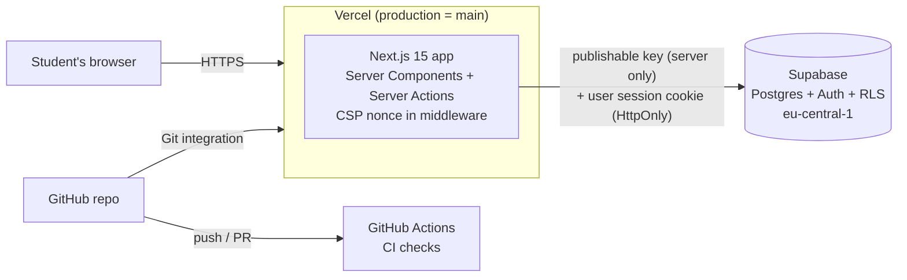

# Architecture

**Owner:** Sif · Source: `PROJECT.md` §12. Hosting changed from Render to **Vercel** on Sat Nov 7 (team decision).

## The parts

| Part | Choice | Why |
|---|---|---|
| App | Next.js 15 (App Router) + TypeScript | Pages and server code in one app; Server Actions keep the database key on the server |
| Hosting | Vercel (Hobby, free) | Builds every push from GitHub, HTTPS, a preview URL for every PR, no sleep like Render's free plan |
| Database + login | Supabase (Postgres + Auth) | Free; real Postgres with Row Level Security; ready-made sessions |
| Container | Docker, multi-stage, `node:24-alpine`, user `node` | Same app on every laptop (`docker compose up`) and checked in CI |
| CI | GitHub Actions | Free for public repos, next to the code |

## Where each secret lives

| Value | Where | Never |
|---|---|---|
| `SUPABASE_URL` | `.env` (local, not committed), Vercel → Environment Variables | in the repo |
| `SUPABASE_PUBLISHABLE_KEY` | `.env` (local), Vercel (type "sensitive") | in the browser: no `NEXT_PUBLIC_` prefix |
| `sb_secret_...` / `service_role` | not used anywhere | the app refuses to start with one |

## Request path (one page view)

1. The browser asks Vercel for `/`.
2. `middleware.ts` makes a new CSP nonce and refreshes the Supabase session cookie.
3. The page calls `search_posts()` through the Supabase client on the server.
4. Postgres applies RLS and the column grants, and returns only public posts.
5. The HTML goes back with the security headers (CSP, HSTS, `X-Frame-Options: DENY`, `nosniff`).
