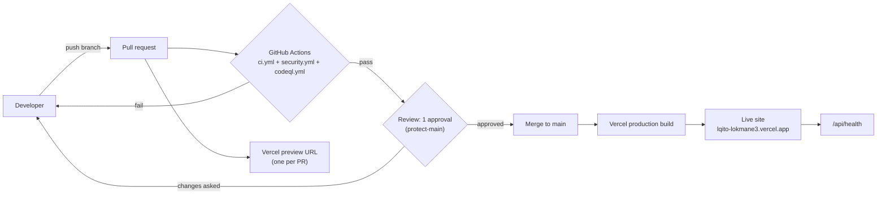

# CI/CD pipeline

**Owner:** Sif · Source: `PROJECT.md` §13, updated for Vercel.

## Jobs

| Workflow | Job | Runs | What it does |
|---|---|---|---|
| `ci.yml` | Lint, typecheck, test, build | every PR + `main` | `npm ci`, `format:check`, `lint`, `typecheck`, `test` (Vitest), `build` |
| `ci.yml` | Docker build | after the job above | builds the Dockerfile (no push), so a broken image is caught before merge |
| `security.yml` | npm audit, gitleaks | every PR + `main` + weekly | Anfel's workflow: vulnerable packages and leaked secrets |
| `codeql.yml` | CodeQL | every PR + `main` + weekly | Anfel's workflow: code scanning for JavaScript/TypeScript |
| Vercel | Preview / Production | every push | builds the app; `main` goes to production |

## Rules

- All actions are pinned to a commit SHA (the tag is in a comment), so a changed tag can't change our pipeline.
- `permissions: contents: read`: the workflows can't push code or change settings.
- `main` is protected: 1 approval, no bypass. Pushing to a PR after an approval cancels the approval.
- Database migrations are **not** run by CI: Lokmane applies them in Supabase after review (no database secret in CI).
