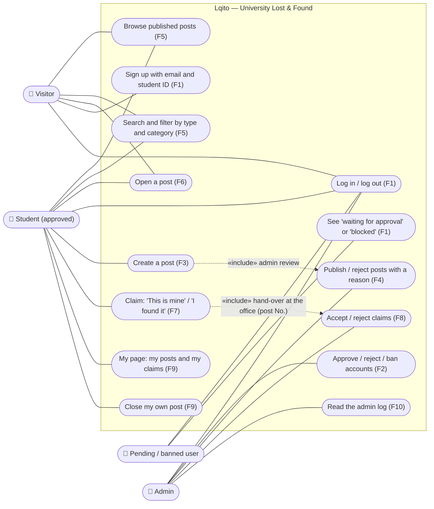

# Use Case diagram

**Owner:** Anfel · Source: `PROJECT.md` §5 (roles) and §6 (features F1–F11).

A Student can do everything a Visitor can; an Admin is also a logged-in user. Pending and banned users can only log in and see their status.

## Notes

- **An admin never reviews their own post or claim** (no conflict of interest). This is checked in SQL.
- **The hand-over happens in person** at the Lost & Found office: the student says the post number ("No. 16") and shows their student card.
- **Not in v1:** chat, photos and email notifications (`PROJECT.md` §6, "Could" and "Won't").
